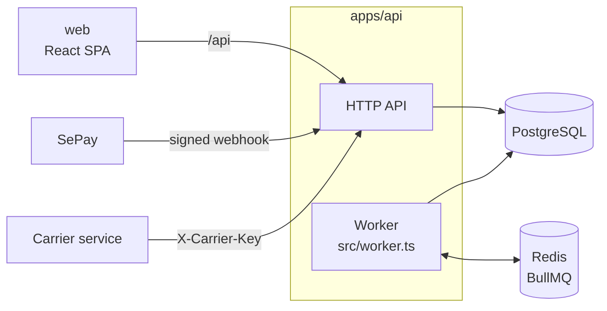

# Marketplace

A multi-seller marketplace in the style of Shopee: one platform, many shops, one cart that splits into an order per shop. The focus is the backend: orders, stock, payments and a double-entry ledger that stay correct under concurrent requests and retried webhooks.

**Stack:** NestJS 12, Prisma 7, PostgreSQL 17, Redis 8 + BullMQ, React 19 + Vite + Tailwind + shadcn/ui, pnpm workspace.

## What it does

- **Buyers** browse shops, fill one cart across shops, check out with cash on delivery or a bank transfer (VietQR through SePay), track and cancel orders, return delivered ones and review what they bought, and search the catalogue without typing accents.
- **Sellers** open a shop (reviewed by an admin), list items with up to two variation tiers, import and export the catalogue as CSV, ship orders, reply to reviews, see earnings by day or month and withdraw their wallet.
- **Admins** review shops and items, see every order and user, settle refunds and read the platform report.
- **A worker** cancels orders that were never paid or shipped in time, completes delivered orders the buyer never confirmed and delivers in-app notifications.

## Architecture



- **Modular monolith.** Auth, catalog, cart, orders, payments, payouts and ledger are Nest modules in one process over one database, so checkout stays a single ACID transaction: stock reservation, orders, payment and ledger commit together or not at all.
- **Worker** is a second entrypoint of the same app (`src/worker.ts`), so it reuses the order and ledger code instead of copying it. A BullMQ job scheduler stored in Redis runs the deadline sweep once a minute no matter how many workers run.
- **Transactional outbox.** Order and return changes write an `outbox_events` row in the same transaction. The worker claims unpublished rows with `FOR UPDATE SKIP LOCKED`, pushes them to a BullMQ queue (job id = event id, retried with exponential backoff) and marks them published; the consumer turns them into notifications.
- **Search** runs in Postgres: `unaccent` is wrapped in an IMMUTABLE `search_text()` so one GIN trigram index serves both `LIKE '%…%'` and fuzzy `<%` matches, and "ao thun" finds "Áo thun".

## Correctness under concurrency

| Problem | How it is handled |
|---|---|
| Two checkouts take the last unit | `UPDATE inventory … WHERE on_hand - reserved >= qty`; the loser gets 409 |
| The same checkout submitted twice | `Idempotency-Key` header, unique per buyer; a replay returns the first result |
| Seller ships while buyer cancels | Every order change locks the row (`SELECT … FOR UPDATE`) and re-checks its status |
| Bank webhook delivered twice | The provider's transaction id is a unique key; the second delivery is a no-op |
| Two payout requests spend one balance | The wallet account row is locked while the balance is checked |
| Worker sweep races a user | The sweep repeats its `WHERE` under the row lock and skips rows that changed |
| Two reviews land on one item at once | Ratings are kept as `rating_count`/`rating_sum` and bumped with atomic increments in the review's transaction; a CHECK keeps the sum within 1–5 × count |
| Worker crashes after queueing an event | The event is queued again; notifications are unique per event and user, so the repeat adds nothing |

## Money and the ledger

Amounts are integer đồng. The ledger is double-entry and append-only: database triggers reject unbalanced entries and any `UPDATE` or `DELETE`, every entry has a unique idempotency key, and balances are always a `SUM` over lines.

| Event | Debit | Credit |
|---|---|---|
| Bank transfer matches a checkout | `bank` | `prepaid` |
| Transfer matches nothing | `bank` | `refund_due` |
| Order completes (COD) | `receivable` | seller `wallet`, `commission`, `shipping` |
| Order completes (paid online) | `prepaid` | seller `wallet`, `commission`, `shipping` |
| Paid order cancelled | `prepaid` | `refund_due` |
| Admin records a refund | `refund_due` | `bank` |
| Seller withdraws | seller `wallet` | `bank` |

Business rules that Shopee does not publish (deadlines, cancel reasons, shipping steps) are marked `Assumption:` in the code; rules with a public source follow it.

## Running it

Requires Node 22, pnpm 11 and Docker.

```bash
cp .env.example .env        # fill in the values
pnpm install
pnpm infra:up               # PostgreSQL + Redis
pnpm db:migrate             # see the note below
pnpm db:seed                # provinces and wards
pnpm dev                    # API on :3000, web on :5173
pnpm dev:worker             # deadline sweeps and outbox relay
pnpm demo:flow              # optional: resets the dev data and drives a full scenario
```

Prisma migrations are kept out of the repository. `pnpm db:migrate` creates one from `schema.prisma`; the CHECK constraints, partial unique indexes and ledger triggers described above are added to that migration by hand.

To run everything in containers instead (API, worker, web behind nginx on http://localhost:8080):

```bash
pnpm app:up
```

## Tests

```bash
pnpm test                                  # unit tests
pnpm --filter @ecommerce/api test:e2e      # e2e against a throwaway database (TEST_DATABASE_URL)
```

The e2e suite drives the real HTTP API against PostgreSQL: checkout races, webhook replays, refunds, payouts and the ledger staying balanced. CI runs lint, unit tests and both builds.

## Layout

```
apps/api        NestJS API and worker (src/modules/*, src/worker.ts)
apps/web        React SPA
packages/db     Prisma schema and generated client
```
