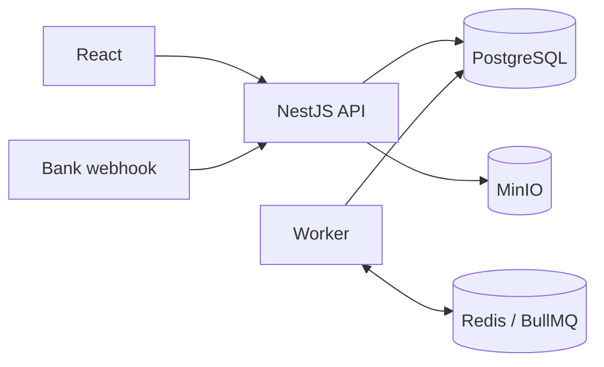

# Marketplace

A multi-shop marketplace in the style of Shopee: one checkout across many shops, shop payouts, platform commission and a double-entry ledger. Backend-focused.

**Stack:** NestJS · Prisma · PostgreSQL · Redis + BullMQ · MinIO · React + Vite · Docker · GitHub Actions

## Highlights

- **No overselling under load.** Flash sale stock and quotas are held inside the checkout transaction. k6: 500 buyers rush 50 units, 50 sold, 0 oversold, p95 2.3 s.
- **Double-entry ledger.** Append-only entries (enforced by a database trigger), idempotency keys on every write, balances computed as sums. Covers settlement, returns, refunds, cash-on-delivery remittance and payouts held until the return window closes.
- **One ACID checkout.** Stock reservation, voucher usage, per-shop orders and ledger entries commit together. Prices are recomputed on the server; an idempotency key makes retries safe.
- **Promotion economics.** Discounts are stored per order line and split by funder. The platform is prevented from funding more than it earns on an order.
- **Reliable background work.** A worker runs scheduled sweeps (auto-cancel, auto-complete, a simulated carrier) and a transactional outbox, so events are never lost or sent for rolled-back changes.
- **Payments.** Bank-transfer payments via a signed (HMAC-SHA256) webhook with replay protection; unmatched transfers are kept for refund.
- **Tested.** 135 end-to-end tests against a real Postgres, unit tests, CI on every push.

## Architecture



A modular monolith: auth, catalog, cart, orders, payments, promotions, inventory, ledger and returns are separate modules over one database, so checkout stays a single transaction. The worker reuses the same modules without HTTP.

Business rules not taken from a published platform policy are marked as assumptions in the code.

## Run locally

Requires Node 22, pnpm 11 and Docker. Fill in `.env` after copying it.

```bash
cp .env.example .env
pnpm install && pnpm infra:up && pnpm db:migrate && pnpm db:seed && pnpm admin:create
pnpm demo:seed     # optional: a year of sample orders
pnpm dev           # web http://localhost:5173, API http://localhost:3000 (Swagger at /docs)
pnpm dev:worker    # background jobs
```

Demo accounts use the password `demo password 123` (e.g. `buyer@demo.vn`, `seller@demo.vn`). The dev login page has one-click buttons.

## Test

```bash
pnpm test && pnpm --filter @ecommerce/api test:e2e && pnpm lint
```
